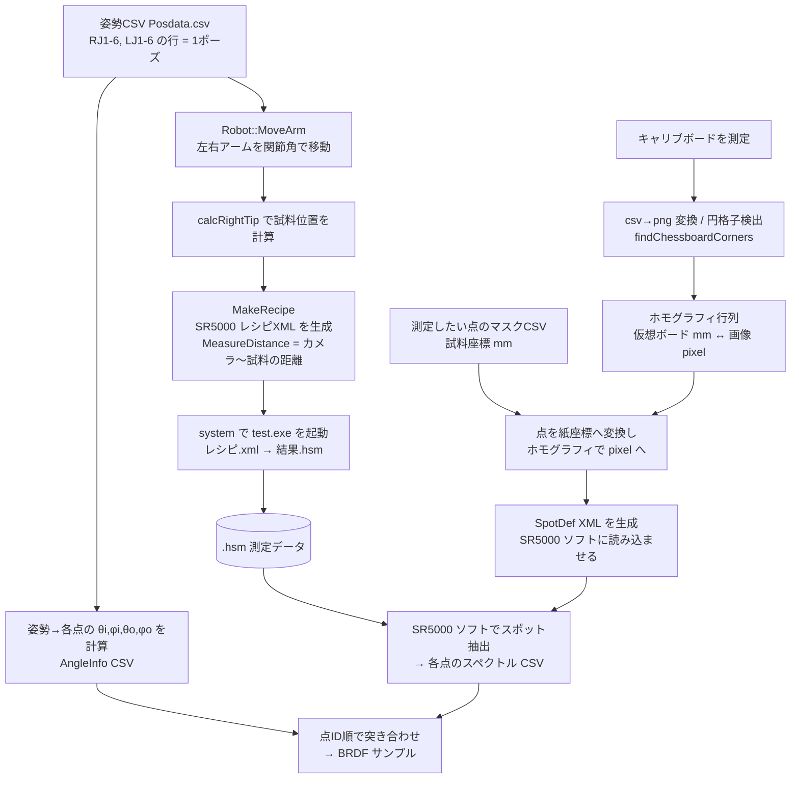

# 旧 2D BRDF 測定システム 解析メモ

対象: 旧システムのプロジェクトフォルダ(`2D_BRDFMeasuring2`)(以下「旧システム」)
関連: 分光放射計を制御する別プログラム `test.exe` のフォルダ

> この資料は旧コードを**読んで**まとめたもので、実機では動かしていません。推測が入る箇所には「(推測)」と書いています。
> コード参照は、旧 `2D_BRDFMeasuring2.cpp`(UTF-16)を `main.cpp` と略して行番号を付けています。

---

## 1. このシステムは何をしているのか(一言で)

**光源を持つロボットアーム(左)と、試料を持つロボットアーム(右)を動かし、固定された 2D 分光放射計で試料を撮影する。**
撮影した画像の「どの点を見るか」を点(スポット)として指定し、各点の「入射角・観察角」をロボットの姿勢から計算して、点ごとに BRDF のサンプルを得る装置です。

「2D」の意味は次のとおりです。試料は平面ですが、光源もカメラも有限の距離にあります。そのため、試料上の場所ごとに入射方向と観察方向が少しずつ違います。1 回の撮影で、1 ポーズあたり数十〜数万点の異なる角度組 (θi, φi, θo, φo) が同時に得られます。

```
                       分光放射計 SR-5000H (固定)
                       位置 (1136, 728, 560) mm
                              ▲
                              │ 撮影
        光源 ───────▶  ┌───────────┐
   (左アーム先端)       │  試料      │ ◀── 右アーム先端
   (-30,108,0)mm       │ (紙+アクリル)│     (ベース位置 (0, 945, 0))
                       └───────────┘
   世界座標の原点 = 左アームのベース
```

## 2. 登場するハードウェア

| 役割 | 実体 | 接続方法 | コード上の場所 |
|---|---|---|---|
| 左アーム(光源側) | DENSO RC8 コントローラ配下の 6 軸アーム | b-CAP / TCP `192.168.0.2:5007` | `header/RC8Params.h`, `source/Robot.cpp` |
| 右アーム(試料側) | 同上 | b-CAP / TCP `192.168.0.5:5007` | 同上 |
| 2D 分光放射計 | TOPCON SR-5000H(`hs_api.h`、CI-100) | USB(想定)。別プログラム `test.exe` を `system()` で起動 | `VS2019/test/test/ソース.cpp` |
| 光源 | 左アーム先端に固定(点灯切替はコードにない) | なし | `header/LightSourcePos.h` |
| キャリブボード | 15×7 の円(ピッチ 25mm、紙 450×302mm) | なし | `header/Paperparam.h` |
| 白色板 | 拡散反射板(基準測定用) | なし | `main.cpp:732` |

左右の割り当て: コード中に「`LoadPosData` を左右入れ替えた(2024-09-25)」というコメントがあります(`main.cpp:177-188`)。**CSV の `RJ`/`LJ` 列と、実機の左右・IP の対応は要確認です。**

## 3. 座標系と幾何

### 3.1 世界座標
- 原点は左アームのベース(床の養生テープが目印、`SpectrometerParam.h` のコメント)。単位は mm。
- 右アームのベースは `(0, 945, 0)`(`RobotParam.h`)。
- カメラ位置は `(1136, 728, 560)`(`SpectrometerParam.h`)。測定のたびに手で合わせて、ヘッダに書き込む運用です。

### 3.2 アーム先端の位置(順運動学)
`Calc::calcLeftTip / calcRightTip`(`source/calc.cpp:381-396`)は、4×4 同次変換行列の積で先端姿勢を出します。

```
T = Trans(0,0,BASE) · RotZ(J1) · RotY(J2) · Trans(0,0,ARM1)
  · RotY(-(90-J3)) · Trans(0,0,JOINT) · RotY(90) · Trans(0,0,ARM2)
  · RotZ(J4) · RotY(J5) · Trans(0,0,ARM3) · RotZ(J6)
```

リンク長は BASE=280、ARM1=210、JOINT=75、ARM2=210、ARM3=70 です。単位は mm、関節角は度です。

- **右アーム**はこれに加えて、世界座標でのベース位置 `(0,945,0)` を前に掛けます。先端側には `Trans(0,0,5+1)` を掛けます。これは**アクリル板 5mm + 紙 1mm の厚み**で、試料面を先端より 6mm 手前として扱うためです。
- **光源の位置**は、左アーム先端の座標系で `Trans(-30, 108, 0)`(`LightSourcePos.h`)だけずらした点です(`Calc::TransLight`)。

### 3.3 角度の定義(`Calc::calcAngle`、`source/calc.cpp:484-537`)
入力は試料点の位置、光源またはカメラの位置、試料面の座標軸 X/Y/Z の単位ベクトルです。

- **θ(天頂角)** = `acos( (r・Z) / |r| )`。r は試料点から光源またはカメラへのベクトルです。
- **φ(方位角)** = 試料面に射影したベクトルが X 軸となす角で、Y 側が正なら `acos`、負なら `2π − acos` とします。射影は `mapvec = r/(r・Z) − Z` です。

**試料面の座標軸**は `getPaperUnitVec`(`calc.cpp:626`)が与えます。

| 試料面の軸 | アーム先端座標系での向き |
|---|---|
| 紙 X | 先端の +Y |
| 紙 Y | 先端の −X |
| 紙 Z(法線) | 先端の +Z |

> この向きの取り違えが、旧コードで最も混乱しやすい箇所です。コード中にも「X と Y がごちゃごちゃ」「間違っているかもしれない」というコメントが複数あります。

## 4. 測定の流れ(1 サイクル)



メニュー(`main.cpp:763`〜)との対応は次のとおりです。

| 入力 | 処理 | 備考 |
|---|---|---|
| `m` | `Measuring(0)` 全ポーズ測定 | `testm`(1)、`testw` 白色板(2)、`calib` キャリブボード(3)は確認メッセージ付きの同系統 |
| `r` | 右アームを正面へ(試料取付用) | 速度 15 |
| `h` / `makespot` / `s` / `s2` | ホモグラフィ計算とスポット XML 生成 | 用途別の複製(後述) |
| `AngleInfo` | 姿勢と点マスクから角度 CSV を出力 | `getAngleInfo` |
| `MakeTable` | 右アーム関節を総当たりした角度表を作成 | 左アーム 3 姿勢 × 各 7⁶ ≒ 11.8 万行 |
| `csv2png` | 分光放射計の CSV → RGB 画像 | `extract_RGB` |
| `test` | 動作確認用シナリオ | `scenario()` |

## 5. ファイルの役割マップ(旧 → 責務)

| 旧ファイル | 実際にやっていること |
|---|---|
| `main.cpp` | メニュー、測定ループ、レシピ生成、スポット生成、パス定数、グローバル設定。**全部入り** |
| `Robot.cpp` | b-CAP でアームを動かす。**同じ約 100 行の関数が 2 つ**ある(速度指定の有無だけ違う)。CSV の姿勢読み込みもここ |
| `RobotParam.cpp` | リンク長などの定数。**コンストラクタでファイル選択ダイアログを開く** |
| `calc.cpp` | 順運動学、角度計算、回転/並進行列、旧プロジェクトの色変換(未使用) |
| `Analysis.cpp` | スポット XML 生成、角度 CSV 出力、角度表(`MakeAngleTable`)作成 |
| `Homography.cpp`, `PaperParam.cpp` | キャリブボードの円格子検出、仮想ボード座標の生成、ホモグラフィ計算 |
| `MakeSpot.cpp` | スポット XML 生成(`Analysis` と重複) |
| `Sample.cpp`, `AgInk_beta.h`, `Paper_gyuhi.h` | 試料の寸法・オフセット・測定点マスク |
| `Lightcls.cpp` | 分光放射計の CSV から `[Spectral]` セクションを読む |
| `AngleTuple/AngleInfo/ID/Posture/RobPos/Output` | 単なるデータ入れ物 |
| `File_GUI`, `SplitCSV`, `stringconverter` | ファイル選択ダイアログ、CSV 分割、文字列変換 |
| `VS2019/test/ソース.cpp` | TOPCON API の薄いラッパー。引数 `レシピ.xml 出力.hsm` |

## 6. データ形式

- **姿勢 CSV**(`Posdata.csv` など): 1 行目がヘッダ `RJ1..RJ6,LJ1..LJ6`、以降 1 行 = 1 ポーズ。角度は度。
  例: `-45,0,90,0,0,0, 45,0,90,0,0,-30`(左アームの J6 だけを少しずつ回して光源の向きを変えていく)
- **レシピ XML**(SR5000 用): テンプレート `Template.xml` の `MeasureDistance mm="…"` だけをポーズごとに書き換えます。種類は、試料、白色板、キャリブボードの 3 つです。
- **スポット XML**(`SpotDef`): `SpotAreaList` の中に `AreaData id=… / AreaCenter x,y / AreaSize 2.00×2.00` を点の数だけ並べます。
- **試料マスク CSV**: 幅×高さの 0/1 行列。1 の位置が測定点です。
- **分光放射計の結果 CSV**: `[Spectral]` タグの次の行がヘッダ、その後に 1 点 1 行。先頭 3 列は座標系の情報で、残りが波長ごとの値です。画像出力では `[R]`/`[G]`/`[B]` と `Resolution(ROI)[pixel]` を読みます。
- **角度 CSV**: `data,in_theta,in_phi,out_theta,out_phi`(度)。

### 点 ID の対応(暗黙の約束)
角度 CSV の n 行目、スポット XML の `id = n`、分光 CSV の n 行目は、**同じ走査順(マスクの j 外側、i 内側)で並んでいる前提**で対応づけています。どこにも明示的な ID 対応はありません。再実装時は、点の ID を陽に持つ設計にすると安全です。

## 7. 「2D」の肝: キャリブボードとホモグラフィ

1. 仮想ボード(`getVirtualCorner2_d`): 円格子の理想的な位置を mm 単位で作ります(15×7、ピッチ 25mm、オフセット XDEF=25/YDEF=51)。
2. キャリブボードを同じ場所に置いて撮影し、画像から円の中心を検出します(`findChessboardCorners`)。
3. 両者の対応から**ホモグラフィ行列 H**(mm → pixel)を作ります。
4. 測定したい点(試料座標 mm)を紙の座標に直します。`+ delta_center + DELTA_X/Y` で、X と Y を取り違えている部分があります。その点に H を掛け、**カメラ画像上の pixel 位置**を得ます。
5. その pixel を `AreaCenter` に書いたスポット XML を作ります。
6. 厚み補正として、`point.x -= 10.86`(`1.81 pixel/mm × 6mm`)があります(`main.cpp:683`)。`s`/`s2` モードでは無効化されています。

## 8. コードの問題点(整理するときの課題)

### 8.1 動作に関わるもの(要確認)
1. **`Measuring()` のロボット移動と姿勢読み込みがコメントアウトされています**(`main.cpp:177-189`、バッテリー交換のため一時削除と記載)。`posR`/`posL` はゼロのままになるので、現状のコードのままでは、**全ポーズが同じ(ゼロ姿勢)で計算されます**。実際のデータ取得時はコメントを外して使っていたはずです。
2. `DEBUG_MAIN` のブロック(`main.cpp:195-218`)は、有効にするとコンパイルが通りません。`;` の欠落と、未定義の `AngleinfoVec`/`TargetPos` があります。
3. `makeorder()`(`Robot.cpp`)が**関節角を `int` に切り捨てて**ロボットに送っています。小数の角度は送れません。
4. `calcAngle` は、法線入射(θ=0)で `mapvec` がゼロになり、φ が NaN になります。
5. `Sample`/`PaperAttachedSample` の「scale 付きコンストラクタ」は、中で別のコンストラクタを呼んでいるだけで、メンバが初期化されません(委譲コンストラクタの書き方の誤り)。
6. `Light(path, 380, 770, …)` の波長範囲は 770 までですが、レシピは 380〜780 nm、1nm ステップです。範囲のずれがあります。
7. `makeangleinfo.cpp` は、名前空間がヘッダと不一致(`make_angelinfo` と `Angleinfo`)で、double の行列を `unsigned char` で読んでいます。事実上使われていないコードです。
8. `getHomography()`(`main.cpp:251`)は、点数が 77(11×7)固定ですが、ボードは 15×7=105 点です。旧版の名残です。

### 8.2 構造上の問題
- **グローバル状態**: `RobotParam rbtprm`(`main.cpp:83`)がグローバルで、起動時にファイル選択ダイアログが開きます。
- **絶対パスの直書き**: `D:/Data/...`、`D:\<旧プロジェクト>\...`、b-CAP のヘッダのパスなどが、コードとヘッダに点在しています。
- **マジックナンバー**: `5`(アクリル)、`1`(紙)、`10.86`、`-30/108`、`151/225` などが、意味の説明なしに埋め込まれています。
- **コピー&ペースト**: 左右アームの順運動学、`MoveArm` ×2、`MakeTable` の 3 重ループ ×3、スポット生成(`h`/`s`/`s2`/`makespot`)、スポット XML 出力(`Analysis` と `MakeSpot`)などです。
- **責務の混在**: 計算関数が、画面表示、ファイル選択、`cin` の入力待ち、`imshow/waitKey` を含んでいます。例は `getVirtualBoardToRealBoardHomography`、`getVirtualCorner2_d` です。
- **通信の都度接続**: `MoveArm` は、1 回動かすたびに b-CAP の接続、モータ ON、移動、モータ OFF、切断を繰り返します。エラー処理もほぼありません。
- **ライブラリ内の `exit()`**: `Light`、`Measuring` などがエラー時にプロセスごと終了します。
- **ヘッダの定義**: `RobPos.h` の関数本体と `RC8Params.h` の `const char*` が、ヘッダに直接書かれています(複数 include で多重定義のおそれ)。`Lightcls.h` はガードのマクロ名が typo です。
- **行列の扱い**: `cv::Mat` で同次座標を扱い、`w=1` に直すために `.at<double>(3,0)=1` を書いています。Eigen の `Isometry3` なら不要です。
- **未使用コード**: `calcRGB_from_XYZ*`、`IsInked`、`step2ref_index`、`calcphi_MERL`、`Debugfunc.h` などです。
- **文字コード**: 本体は UTF-16、ヘッダ類の大半は CP932 と、混在しています。

## 9. 新システムへの対応づけ

### 9.1 現在の新システムのインターフェースと旧システムのギャップ
| 新システム | 旧システムとのずれ |
|---|---|
| `IRobotArm::moveJ(JointAngles[rad], speed)` | 旧は**関節空間の移動(`J(…)`)が中心**で `moveJ` と合う。角度は度で、int に丸めていた。`moveL` は旧では使っていない |
| `ISpectrometer::measure() → Spectrum`(1 本のスペクトル) | **旧は 2D の分光放射計。レシピ+スポット指定で、多数点のスペクトルを一度に得る**。1 本のスペクトルを返すインターフェースでは合わない |
| `ILightSource`(点灯・強度) | 旧の光源は**左アーム先端に固定**で、点灯は制御しない。重要なのは「位置」 |
| `Recipe::points = MeasurementPoint(θi,φi,θo,φo)` | 旧は**関節姿勢(ポーズ)が入力で、角度は出力**。角度から姿勢を逆算する仕組みはなく、姿勢を総当たりして角度表を作り、そこから選んでいた |
| `Recipe::Geometry`(ほぼ空) | 旧のカメラ位置、光源オフセット、右ベース位置、試料厚み、紙のオフセットなどが入る場所 |

### 9.2 提案する責務分割(たたき台)
| 新モジュール(案) | 旧の対応物 | 役割 |
|---|---|---|
| `driver/Rc8Arm : IRobotArm` | `Robot.cpp`, `RC8Params.h` | b-CAP を RAII で包む。接続は 1 回、エラーは `tl::expected`、速度設定、小数の角度 |
| `kinematics/Rc8Kinematics` | `calcLeftTip/RightTip`, `RobotParam` | 関節角 → 先端姿勢(Eigen の `Isometry3`)。リンク長は設定ファイル |
| `geometry/SetupConfig`(TOML) | `SpectrometerParam`, `LightSourcePos`, `Paperparam`, 厚み定数 | 装置の配置パラメータをコードから分離 |
| `optics/computeAngles()` | `calcAngle` | 純粋関数。座標系の約束(§3.3)を 1 か所に集約し、θ=0 の特異点も処理 |
| `calibration/BoardHomography` | `Homography.cpp`, `PaperParam.cpp` | 円格子検出とホモグラフィ。表示や入力待ちは持たない |
| `spot/SpotPlanner` + `SpotFileWriter` | `Sample`, `MakeSpot`, `Analysis::WriteSpotData` | 点の定義(ID 付き)、pixel 変換、SpotDef XML 出力 |
| `driver/ISpectralImager` | `test.exe`, `MakeRecipe` | TOPCON `hs_api` を直接呼ぶ。`system()` による別プロセス起動をやめる |
| `io/SpectrumCsvReader` | `Lightcls.cpp` | `[Spectral]` の読み込み。`exit()` は使わない |
| `app/MeasurementSession` + CLI(`cli11`) | `Measuring`, `main` | ポーズの巡回、キャリブ→白色板→試料の順序、保存先の管理 |
| `planning/PosePlanner` | `MakeTable` | 角度表の作成。将来は逆運動学 |

### 9.3 `Recipe` の設計メモ
`Recipe` の中心は、**ポーズ列(左右の関節角)**にするのがよいと考えます。角度 `(θi,φi,θo,φo)` は、ポーズと点から導いた結果として扱います。目標角度から姿勢を選びたい場合は、別途 `PosePlanner` の入力にします。

## 10. 要確認事項

1. `RJ`/`LJ` 列と、実機の左右アーム・IP アドレス(`.5` と `.2`)の対応。
2. `hsm` → スポット抽出 → 分光 CSV の変換は、コード内に見当たりません。TOPCON ソフトの GUI で手作業だったのか、別ツールがあったのか。
3. BRDF への最終処理(白色板による正規化、色変換など)はどこで行っていたのか。コメントでは「microBRDF プロジェクトの `Colorman` クラス」とあります。
4. 実際に使った装置パラメータ(カメラ位置など)は、測定日ごとにヘッダを書き換えていたのか。履歴の管理方法。
5. 新システムの `ISpectrometer` を、2D 分光放射計向けに作り直してよいか。

## 11. 参考: 旧システムの主な測定データと設定の置き場所
- 姿勢: `Posdata.csv`(52 ポーズ)、`Posdata_2.csv`(21)、`Posdata_trial.csv`(3)
- レシピ: `SR5000_recipe/1〜52.xml`、`tutorial/recipe/`、`AgInkBeta_recipe/`
- スポット: `spotdata/`、`AgInkBeta/spotdata/`
- 試料パラメータ: `SamplePosData/AgInk_beta.h`、`header/Paper_gyuhi.h`
- バックアップ: `backup/`(ver1.0〜ver1.1、20201116)

## 12. P1 で判明したこと(旧データとの照合結果)

新システムの順運動学と角度計算を、旧システムが出力した `D:\Data\AngleTable\out1〜3.csv`(全 353,000 行)と照合しました。
**許容誤差 0.002°(CSV の丸め)以内で全行一致**しています(ただし下記 2 の θ>90° の行は、旧コードのバグによる φ の反転を考慮した比較です)(`tests/test_old_system_golden.cpp`)。
旧コードの式(§3.2 の順運動学、§3.3 の角度)は正しく理解できていたことが確認できました。照合の過程で、次のことが分かりました。

1. **角度表のカメラ位置は (1272, 710, 554) mm でした。** 現在のヘッダ値 (1136, 728, 560) とは違います。
   データから逆算しました(残差 0.0005° 以内)。カメラ位置は測定日ごとにヘッダを書き換える運用だったため、
   **当時のデータは、当時のパラメータを知らないと再現できません**。新システムでは `setup.toml` として測定結果と一緒に保存します。
2. **旧 `calcAngle` は、θ>90°(光源またはカメラが基準面の裏側)のとき、φ が 180° 反転して出力されます。**
   射影ベクトルを `r/(r·Z) − Z` で作っているためです。旧コードも「cos の値が負になりました」と警告を出していた領域です。
   角度表の約 3.4% の行(352,947 行中 11,879 行)が該当します。新システムは正しい方位角を返します。
3. **角度表と試料点ごとの角度で、座標系が違います。**
   - `MakeAngleTable`(角度表)は、アーム先端の座標系 (`getUnitVecs`) で測っています。
   - `OutputAngles`(試料点ごとの角度)は、紙の座標系 (`getPaperUnitVec`) で測っています。
   - 両者の φ は 90° ずれます(φ_紙 = φ_先端 − 90°)。同じ「φ」という名前で混在すると危険です。
   新システムでは `RigGeometry::tipFrame` と `paperFrame` に分け、標準は紙の座標系にしました。

法線入射(θ=0)で φ が NaN になる問題は、新システムでは φ=0 を返すことで解消しています。
